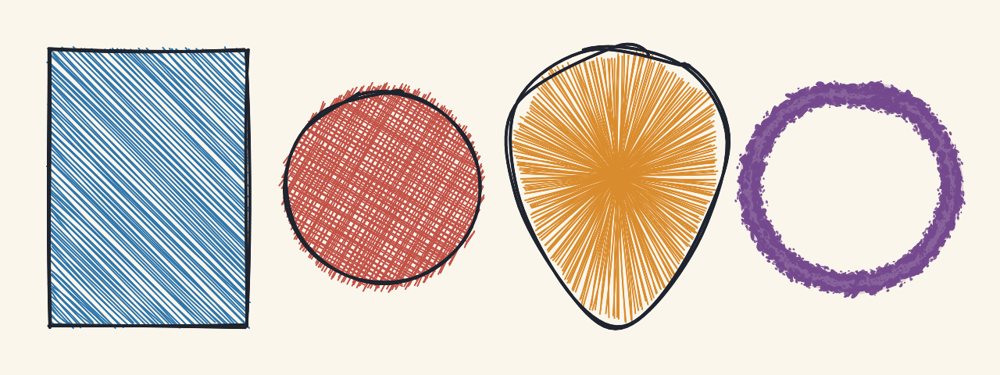
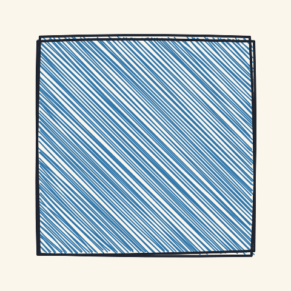
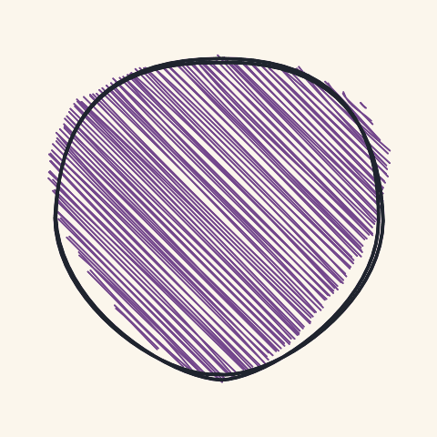
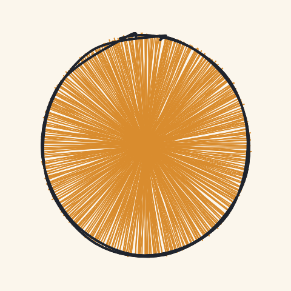
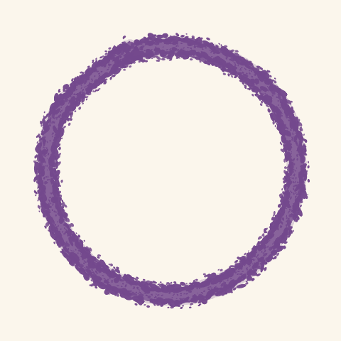
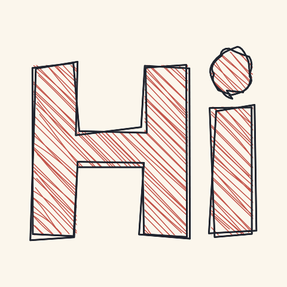
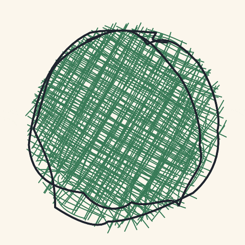

# Sketchy



Sketchy draws shapes, SVG paths, and text in a hand-drawn style, in SwiftUI. Strokes are built by a native Swift port of the rough.js algorithms, then painted with `Canvas`. A seed redraws the same picture. Fill lines, brushes, and a wax-crayon stroke are part of the same view.

For AI coding agents: [AGENTS.md](AGENTS.md) is how to work in this repo, and [llms.txt](llms.txt) is the library API cheat-sheet.

## Installation

Add the package to your `Package.swift` dependencies and to the target that uses it. The package requires iOS 17 or later.

```swift
.package(url: "https://github.com/sstradling/Sketchy", from: "1.2.0"),
```

```swift
.product(name: "Sketchy", package: "Sketchy")
```

```swift
import SwiftUI
import Sketchy
```

## Renamed from RoughSwiftUI

The package, library product, and module were renamed to Sketchy in 1.2.0. Public type names did not change.

1. Point the package URL at `https://github.com/sstradling/Sketchy` and require `1.2.0`.
2. Depend on `.product(name: "Sketchy", package: "Sketchy")`.
3. Replace `import RoughSwiftUI` with `import Sketchy`.

`RoughView`, `RoughText`, `AnimatedRoughView`, and the other public types keep their names.

## Quick start

Give the view a frame. `.seed(42)` keeps the wobble stable across redraws. Hachure at 45° is the default fill angle.



```swift
RoughView()
    .fill(Color(red: 0.18, green: 0.46, blue: 0.67))
    .fillStyle(.hachure)
    .fillAngle(45)
    .fillSpacing(3)
    .stroke(Color(red: 0.12, green: 0.14, blue: 0.18))
    .strokeWidth(2)
    .seed(42)
    .rectangle()
    .frame(width: 240, height: 240)
```

## Examples

A short tour is below. The full set, with a picture and the snippet that drew it, is in [Examples](docs/Examples.md).

### Shapes

`.egg(tilt:)` narrows the top. `.curveStepCount` sets how many samples build the outline. Lines, arcs, polygons, curves, and rounded rectangles are in the catalog.



```swift
RoughView()
    .fill(Color(red: 0.45, green: 0.28, blue: 0.55))
    .fillStyle(.hachure)
    .fillSpacing(3)
    .stroke(Color(red: 0.12, green: 0.14, blue: 0.18))
    .strokeWidth(2)
    .curveStepCount(16)
    .seed(28)
    .egg(tilt: 0.4)
```

### Fills

`.sunBurst` draws rays from the center. `.starBurst` uses the same filler. Other styles are `.hachure`, `.solid`, `.zigzag`, `.crossHatch`, `.dots`, `.dashed`, `.zigzagLine`, and `.scribble`.



```swift
RoughView()
    .fill(Color(red: 0.85, green: 0.55, blue: 0.18))
    .fillStyle(.sunBurst)
    .fillSpacing(2.2)
    .stroke(Color(red: 0.12, green: 0.14, blue: 0.18))
    .strokeWidth(2)
    .seed(55)
    .circle()
```

### Crayon

`.brushProfile(.crayon)` lays a wax stroke. `strokeWidth` is the wax width in points. Hachure and zigzag lines pick up the same wax, at `fillWeight`.



```swift
RoughView()
    .stroke(Color(red: 0.45, green: 0.28, blue: 0.55))
    .strokeWidth(11)
    .brushProfile(.crayon(grit: 0.95, flakeSize: 1.5, seed: 4))
    .seed(4)
    .circle()
```

Presets that are not crayon: `.calligraphic`, `.marker`, `.pen`, and `.default`.

### Text

Text is traced to a path and drawn at the font size you set. It is placed in the view. It is not scaled to fill the frame the way an SVG path is. `.leading` and `.top` pin it to a corner. `offsetX` and `offsetY` move it after that. Positive x goes right. Positive y goes down.



```swift
RoughView()
    .fill(Color(red: 0.76, green: 0.32, blue: 0.28))
    .fillStyle(.hachure)
    .fillAngle(45)
    .fillSpacing(2)
    .stroke(Color(red: 0.12, green: 0.14, blue: 0.18))
    .strokeWidth(1.5)
    .seed(151)
    .text("Hi", font: .systemFont(ofSize: 76, weight: .heavy))
```

`RoughText` is the same drawing sized to the glyphs, so it can sit beside another view.

### Animation

`.animated(config:)` loops a seeded wobble. `AnimationConfig.seed` replays the same frames. The convenience `.animated(steps:speed:variance:)` does not take a seed.



```swift
RoughView()
    .fill(Color(red: 0.22, green: 0.48, blue: 0.34))
    .fillStyle(.crossHatch)
    .fillAngle(30)
    .fillSpacing(3)
    .stroke(Color(red: 0.12, green: 0.14, blue: 0.18))
    .strokeWidth(2)
    .seed(42)
    .circle()
    .animated(config: AnimationConfig(steps: 6, speed: .medium, variance: .high, seed: 42))
```

| Speed | Step |
| --- | --- |
| `.slow` | 600 ms |
| `.medium` | 300 ms |
| `.fast` | 100 ms |

| Variance | Amount |
| --- | --- |
| `.veryLow` | 0.5% |
| `.low` | 1% |
| `.medium` | 5% |
| `.high` | 10% |

## Options

`Options` is copied through the builder methods on `RoughView`. One view has one set of options. Stack views when a drawing needs two colours.

| Modifier | Default | What it changes |
| --- | --- | --- |
| `.roughness` | 1 | How far strokes and fill lines jitter |
| `.bowing` | 1 | How much long edges bend |
| `.maxRandomnessOffset` | 2 | How far the two outline passes wander |
| `.stroke` / `.fill` | black / clear | Line colour and interior colour |
| `.strokeWidth` | 1 | Outline width, in points |
| `.strokeOpacity` / `.fillOpacity` | 100 | 0 is clear, 100 is opaque |
| `.fillStyle` | `.hachure` | Interior pattern |
| `.fillWeight` | half the stroke, at least 1 | Width of each fill line |
| `.fillAngle` | 45 | Degrees clockwise from horizontal |
| `.fillSpacing` | 4 | Gap as a multiple of the fill weight, from 0.5 to 100 |
| `.seed` | `nil` | Stable random sequence. `nil` picks a new drawing on a cache miss |

### Fill angle

`0` is horizontal and `90` is vertical for hachure, zigzag, cross-hatch, dashed, and zigzag-line. Positive angles rotate clockwise because Core Graphics y points down. Dots stay on the horizontal grid. Scribble strokes use `scribbleOrigin` with that same bearing. Sunburst fills are radial and ignore `fillAngle`.

### Seed

`.seed(42)` restarts a SplitMix64 sequence for that drawing. The same seed and the same options redraw the same strokes.

Crayon grain uses `CrayonStyle.seed`. When that seed is still `CrayonStyle.defaultSeed` (`1`) and `Options.seed` is set, the grain comes from `Options.seed`. Any other crayon seed wins. `AnimationConfig.seed` is separate and only affects the animation frames.

### Scribble

`.fillStyle(.scribble)` draws one continuous zig-zag across the shape.

| Modifier | Default | Range |
| --- | --- | --- |
| `.scribbleOrigin` | 0 | Degrees. 0 goes right, 90 goes down |
| `.scribbleTightness` | 10 | 1 to 100 zig-zags |
| `.scribbleCurvature` | 0 | 0 to 50 |
| `.scribbleUseBrushStroke` | false | Draw the zig-zag with the current brush |
| `.scribbleTightnessPattern` | none | Density bands, such as `[6, 24, 8, 28]` |

### SVG paths

`.draw(Path(d:))` scales the path to the view and keeps its aspect ratio. `.svgStrokeWidth`, `.svgFillWeight`, and `.svgFillStrokeAlignment` (`.center`, `.inside`, `.outside`) apply to that path. Text is also stored as a path, but it is placed in the view and is not scaled to fit.

### Brushes

| Profile | Look |
| --- | --- |
| `.default` | Even round stroke |
| `.calligraphic` | Flat tip at 45°, tapered ends |
| `.marker` | Flat tip, butt caps |
| `.pen` | Pressure swell through the middle |
| `.crayon` | Continuous wax with grit on top |

`.thicknessProfile(.naturalPen)` tapers an open stroke. Closed shapes keep an even width so the join does not seam.

## Shapes

Auto-sized, filling the view: `.rectangle()`, `.circle()`, `.roundedRectangle(cornerRadius:)`, `.egg(tilt:)`, and `.text`.

Placed with `.draw`: `Line`, `Rectangle`, `Ellipse`, `Circle`, `LinearPath`, `Arc`, `Curve`, `Polygon`, `Path`, `RoundedRectangle`, and `EggShape`.

## Performance

Generators are cached by size. Drawings are cached by shape and by the options that change geometry, including the seed. How to clear those caches, and how to read the signposts in Instruments, is in [Performance](docs/Performance.md).

## Author

**Seth Stradling** - [@sstradling](https://github.com/sstradling)

## Credits

- [**RoughSwift**](https://github.com/onmyway133/RoughSwift) by [Khoa Pham](https://github.com/onmyway133). Sketchy keeps that SwiftUI API and replaces the JavaScript engine with a native generator.
- [**rough.js**](https://github.com/pshihn/rough) by Prashant Sharma. The hand-drawn line, fill, and curve algorithms come from rough.js.
- [**SVGPath**](https://github.com/timrwood/SVGPath) by Tim Wood. SVG path parsing.

## License

Sketchy is available under the MIT license. See the [LICENSE](LICENSE) file for more info.
