# Examples

Rendered by `scripts/render-docs.sh` from the `DocExample` catalog. Each example sets a fixed seed so the picture matches the snippet. Tiles are light paper cards.

## Contents

- [Basics](#basics)
- [Shapes](#shapes)
- [Fills](#fills)
- [Strokes](#strokes)
- [Roughness](#roughness)
- [Brushes](#brushes)
- [Seeding](#seeding)
- [SVG](#svg)
- [Text](#text)
- [Animation](#animation)

## Basics

### Hachure rectangle

A seeded rectangle with hachure at 45°, the default fill angle.

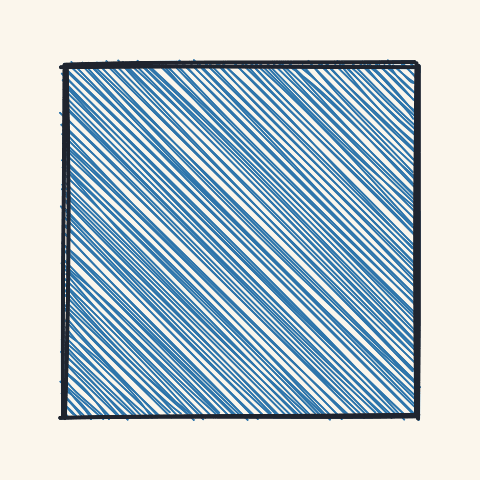

```swift
RoughView()
    .fill(Color(red: 0.18, green: 0.46, blue: 0.67))
    .fillStyle(.hachure)
    .fillAngle(45)
    .fillSpacing(3)
    .stroke(Color(red: 0.12, green: 0.14, blue: 0.18))
    .strokeWidth(2)
    .seed(42)
    .rectangle()
```

## Shapes

### Ellipse

An ellipse placed by center, width, and height inside the card.

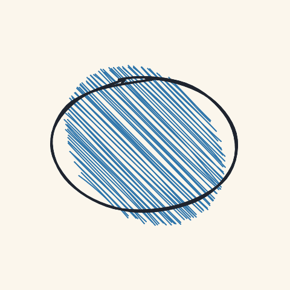

```swift
RoughView()
    .fill(Color(red: 0.18, green: 0.46, blue: 0.67))
    .fillStyle(.hachure)
    .fillSpacing(3)
    .stroke(Color(red: 0.12, green: 0.14, blue: 0.18))
    .strokeWidth(2)
    .seed(14)
    .draw(Ellipse(x: 92, y: 92, width: 150, height: 108))
```

### Circle

A circle that fills the card. The diameter follows the shorter side.

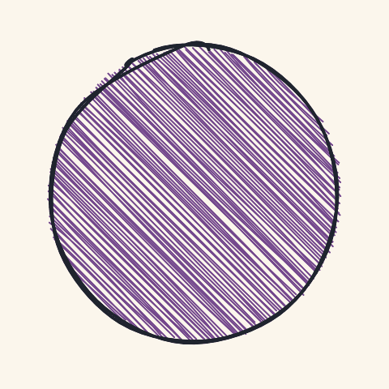

```swift
RoughView()
    .fill(Color(red: 0.45, green: 0.28, blue: 0.55))
    .fillStyle(.hachure)
    .fillAngle(45)
    .fillSpacing(3)
    .stroke(Color(red: 0.12, green: 0.14, blue: 0.18))
    .strokeWidth(2)
    .seed(15)
    .circle()
```

### Line

A single line from one point to another. The outline is two offset passes.

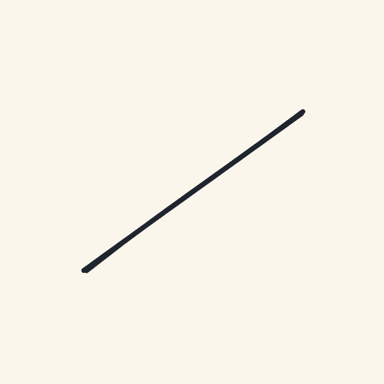

```swift
RoughView()
    .stroke(Color(red: 0.12, green: 0.14, blue: 0.18))
    .strokeWidth(3)
    .roughness(1.3)
    .seed(16)
    .draw(Line(from: Point(x: 24, y: 140), to: Point(x: 160, y: 44)))
```

### Open arc

An arc in radians. This one stays open, so it is a stroke without a pie fill.

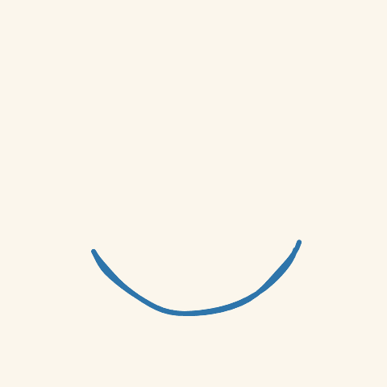

```swift
RoughView()
    .stroke(Color(red: 0.18, green: 0.46, blue: 0.67))
    .strokeWidth(3)
    .seed(17)
    .draw(Arc(
        x: 92,
        y: 96,
        width: 140,
        height: 140,
        start: Float.pi * 0.15,
        stop: Float.pi * 0.85,
        closed: false
    ))
```

### Closed arc

A closed arc draws the chord back to the center and fills the wedge.

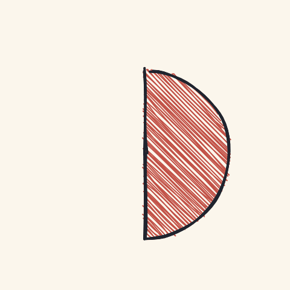

```swift
RoughView()
    .fill(Color(red: 0.76, green: 0.32, blue: 0.28))
    .fillStyle(.hachure)
    .fillSpacing(2.5)
    .stroke(Color(red: 0.12, green: 0.14, blue: 0.18))
    .strokeWidth(2)
    .seed(19)
    .draw(Arc(
        x: 92,
        y: 100,
        width: 140,
        height: 140,
        start: -Float.pi / 2,
        stop: Float.pi / 2,
        closed: true
    ))
```

### Polygon

A closed polygon through the given points. The last edge joins back to the first.

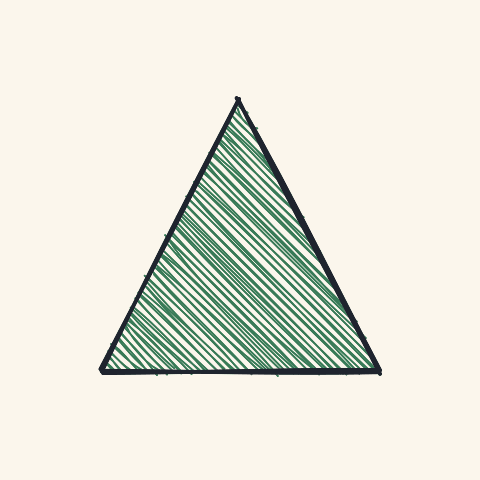

```swift
RoughView()
    .fill(Color(red: 0.22, green: 0.48, blue: 0.34))
    .fillStyle(.hachure)
    .fillAngle(45)
    .fillSpacing(3)
    .stroke(Color(red: 0.12, green: 0.14, blue: 0.18))
    .strokeWidth(2)
    .seed(21)
    .draw(Polygon(points: [
        Point(x: 92, y: 22),
        Point(x: 162, y: 158),
        Point(x: 22, y: 158)
    ]))
```

### Linear path

An open polyline. Unlike a polygon, the ends are not joined and there is no fill.

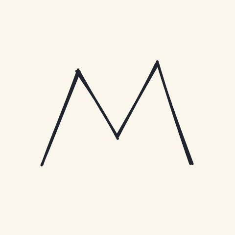

```swift
RoughView()
    .stroke(Color(red: 0.12, green: 0.14, blue: 0.18))
    .strokeWidth(2.5)
    .seed(23)
    .draw(LinearPath(points: [
        Point(x: 16, y: 140),
        Point(x: 52, y: 44),
        Point(x: 92, y: 112),
        Point(x: 132, y: 36),
        Point(x: 168, y: 140)
    ]))
```

### Curve

A spline through the points. curveTightness(0.8) pulls it toward those points.

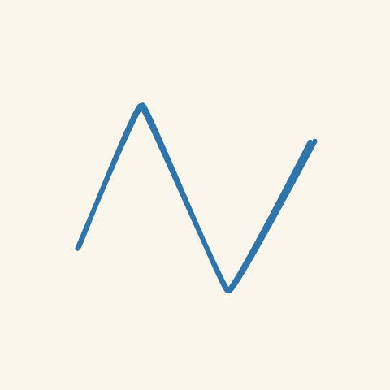

```swift
RoughView()
    .stroke(Color(red: 0.18, green: 0.46, blue: 0.67))
    .strokeWidth(3)
    .curveTightness(0.8)
    .seed(24)
    .draw(Curve(points: [
        Point(x: 20, y: 124),
        Point(x: 60, y: 36),
        Point(x: 112, y: 150),
        Point(x: 164, y: 60)
    ]))
```

### Rounded rectangle

A full-card rectangle with a shared corner radius of 36 points.

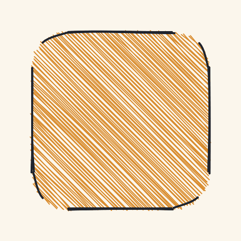

```swift
RoughView()
    .fill(Color(red: 0.85, green: 0.55, blue: 0.18))
    .fillStyle(.hachure)
    .fillSpacing(3)
    .stroke(Color(red: 0.12, green: 0.14, blue: 0.18))
    .strokeWidth(2)
    .seed(27)
    .roundedRectangle(cornerRadius: 36)
```

### Egg

tilt 0.4 narrows the top. curveStepCount(16) sets how many samples build the outline.

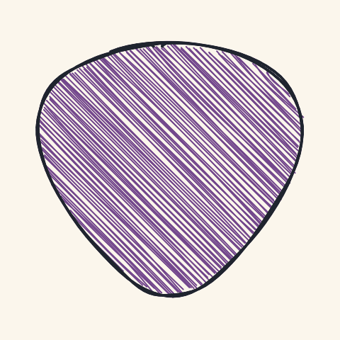

```swift
RoughView()
    .fill(Color(red: 0.45, green: 0.28, blue: 0.55))
    .fillStyle(.hachure)
    .fillSpacing(3)
    .stroke(Color(red: 0.12, green: 0.14, blue: 0.18))
    .strokeWidth(2)
    .curveStepCount(16)
    .seed(28)
    .egg(tilt: 0.4)
```

## Fills

### Horizontal hachure

Hachure at 0° runs horizontally. Positive angles rotate clockwise.

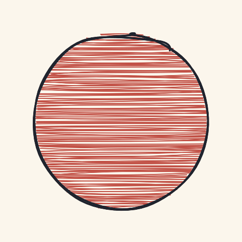

```swift
RoughView()
    .fill(Color(red: 0.76, green: 0.32, blue: 0.28))
    .fillStyle(.hachure)
    .fillAngle(0)
    .fillSpacing(2.5)
    .stroke(Color(red: 0.12, green: 0.14, blue: 0.18))
    .strokeWidth(2)
    .seed(11)
    .circle()
```

### Vertical hachure

Hachure at 90° runs from top to bottom.

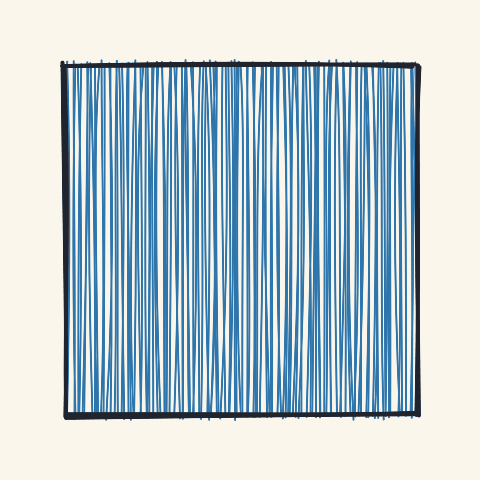

```swift
RoughView()
    .fill(Color(red: 0.18, green: 0.46, blue: 0.67))
    .fillStyle(.hachure)
    .fillAngle(90)
    .fillSpacing(3)
    .stroke(Color(red: 0.12, green: 0.14, blue: 0.18))
    .strokeWidth(2)
    .seed(31)
    .rectangle()
```

### Clockwise hachure

20° is a shallow clockwise slope from the horizontal axis.

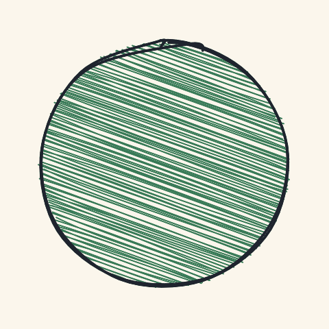

```swift
RoughView()
    .fill(Color(red: 0.22, green: 0.48, blue: 0.34))
    .fillStyle(.hachure)
    .fillAngle(20)
    .fillSpacing(3)
    .stroke(Color(red: 0.12, green: 0.14, blue: 0.18))
    .strokeWidth(2)
    .seed(33)
    .circle()
```

### Solid fill

A solid interior. The outline stays sketchy.

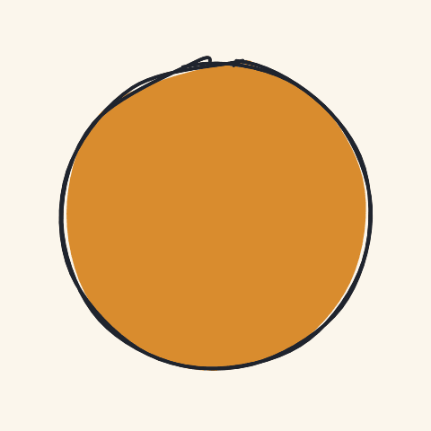

```swift
RoughView()
    .fill(Color(red: 0.85, green: 0.55, blue: 0.18))
    .fillStyle(.solid)
    .stroke(Color(red: 0.12, green: 0.14, blue: 0.18))
    .strokeWidth(2)
    .seed(36)
    .circle()
```

### Zigzag fill

Hachure lines joined at the ends, so the fill is one zigzagging stroke.

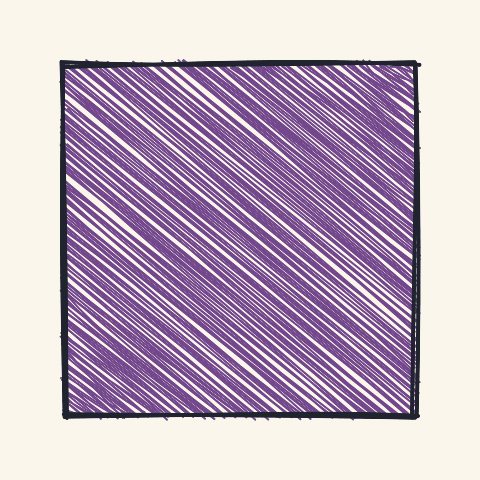

```swift
RoughView()
    .fill(Color(red: 0.45, green: 0.28, blue: 0.55))
    .fillStyle(.zigzag)
    .fillAngle(40)
    .fillSpacing(3.5)
    .stroke(Color(red: 0.12, green: 0.14, blue: 0.18))
    .strokeWidth(2)
    .seed(37)
    .rectangle()
```

### Cross-hatch

Two hachure passes. The second sits across the first.

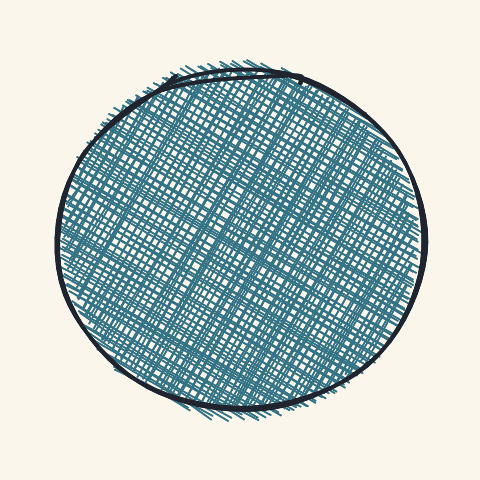

```swift
RoughView()
    .fill(Color(red: 0.20, green: 0.45, blue: 0.52))
    .fillStyle(.crossHatch)
    .fillAngle(30)
    .fillSpacing(3.5)
    .stroke(Color(red: 0.12, green: 0.14, blue: 0.18))
    .strokeWidth(2)
    .seed(41)
    .circle()
```

### Dots

A dot grid. Dots stay on the horizontal lattice and ignore fillAngle.

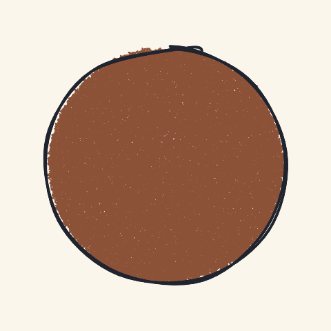

```swift
RoughView()
    .fill(Color(red: 0.55, green: 0.32, blue: 0.22))
    .fillStyle(.dots)
    .fillSpacing(2.2)
    .stroke(Color(red: 0.12, green: 0.14, blue: 0.18))
    .strokeWidth(2)
    .seed(44)
    .circle()
```

### Dashed fill

Hachure broken into dashes. dashOffset is the dash length and dashGap is the skip.

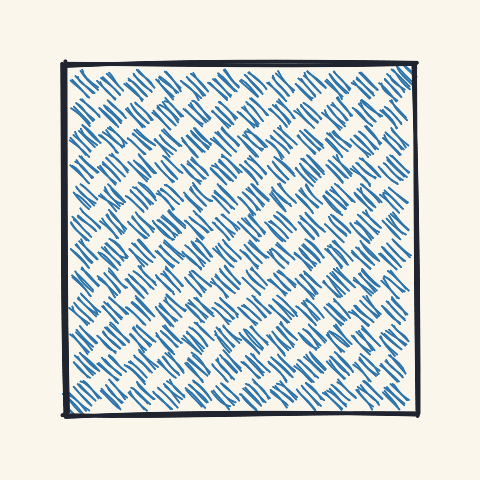

```swift
RoughView()
    .fill(Color(red: 0.18, green: 0.46, blue: 0.67))
    .fillStyle(.dashed)
    .fillAngle(45)
    .fillSpacing(3)
    .dashOffset(12)
    .dashGap(8)
    .stroke(Color(red: 0.12, green: 0.14, blue: 0.18))
    .strokeWidth(2)
    .seed(48)
    .rectangle()
```

### Zigzag line

Each hachure line is itself a zigzag. zigzagOffset(14) sets the size of those peaks.

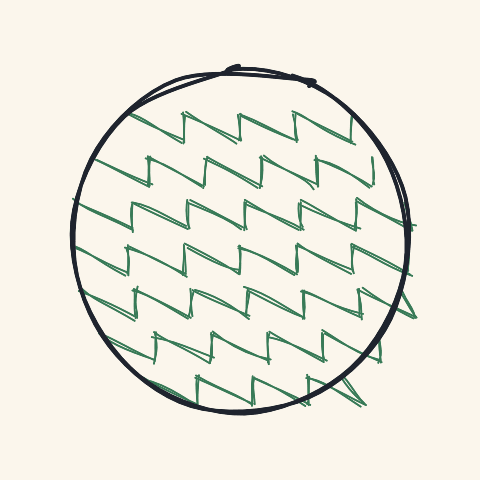

```swift
RoughView()
    .fill(Color(red: 0.22, green: 0.48, blue: 0.34))
    .fillStyle(.zigzagLine)
    .fillAngle(0)
    .fillSpacing(4)
    .zigzagOffset(14)
    .stroke(Color(red: 0.12, green: 0.14, blue: 0.18))
    .strokeWidth(2)
    .seed(52)
    .circle()
```

### Sunburst

Rays from the center. .starBurst draws this same radial filler.

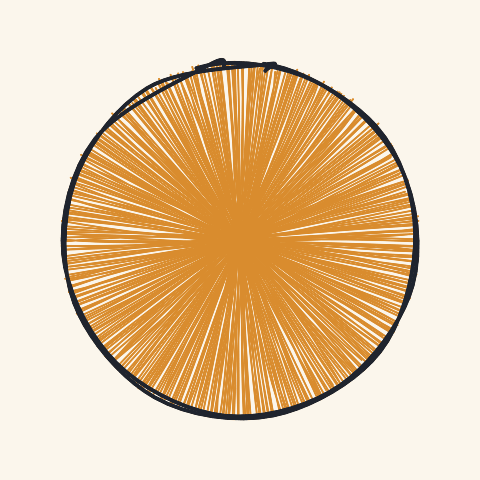

```swift
RoughView()
    .fill(Color(red: 0.85, green: 0.55, blue: 0.18))
    .fillStyle(.sunBurst)
    .fillSpacing(2.2)
    .stroke(Color(red: 0.12, green: 0.14, blue: 0.18))
    .strokeWidth(2)
    .seed(55)
    .circle()
```

### Scribble

One continuous zig-zag that crosses the shape. The bearing comes from scribbleOrigin.

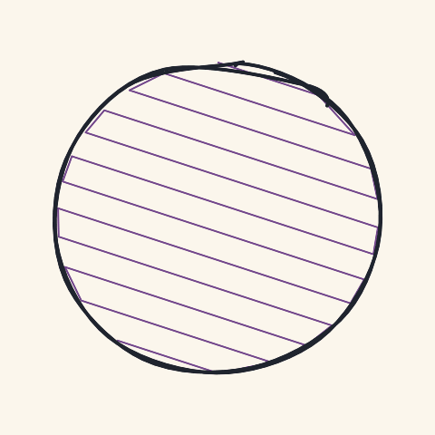

```swift
RoughView()
    .fill(Color(red: 0.45, green: 0.28, blue: 0.55))
    .fillStyle(.scribble)
    .scribble(origin: 18, tightness: 14, curvature: 0)
    .stroke(Color(red: 0.12, green: 0.14, blue: 0.18))
    .strokeWidth(2)
    .seed(61)
    .circle()
```

### Heavy fill lines

fillWeight(5) thickens each hachure line. fillSpacing(1.6) keeps them close.

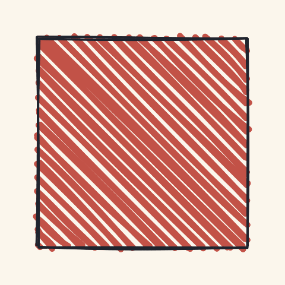

```swift
RoughView()
    .fill(Color(red: 0.76, green: 0.32, blue: 0.28))
    .fillStyle(.hachure)
    .fillAngle(45)
    .fillWeight(5)
    .fillSpacing(1.6)
    .stroke(Color(red: 0.12, green: 0.14, blue: 0.18))
    .strokeWidth(2)
    .seed(64)
    .rectangle()
```

### Wide fill gap

fillSpacing(9) opens the gap between thin hachure lines. The factor multiplies fillWeight.

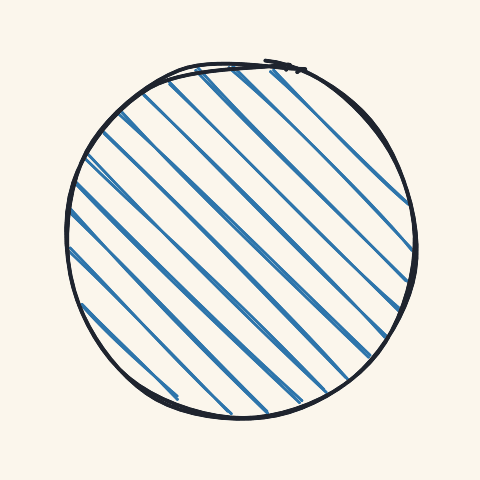

```swift
RoughView()
    .fill(Color(red: 0.18, green: 0.46, blue: 0.67))
    .fillStyle(.hachure)
    .fillAngle(45)
    .fillWeight(1.5)
    .fillSpacing(9)
    .stroke(Color(red: 0.12, green: 0.14, blue: 0.18))
    .strokeWidth(2)
    .seed(67)
    .circle()
```

### Spacing pattern

fillSpacingPattern stacks a hachure pass for each multiplier of fillSpacing. The tightest pass covers the shape.

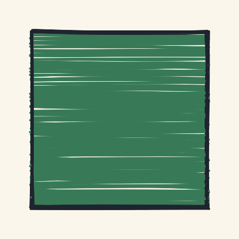

```swift
RoughView()
    .fill(Color(red: 0.22, green: 0.48, blue: 0.34))
    .fillStyle(.hachure)
    .fillAngle(0)
    .fillWeight(2)
    .fillSpacing(2)
    .fillSpacingPattern([1, 1, 2, 3, 5, 8])
    .stroke(Color(red: 0.12, green: 0.14, blue: 0.18))
    .strokeWidth(2)
    .seed(71)
    .rectangle()
```

### Curved scribble

scribbleOrigin(110) aims the strokes, tightness(11) sets the count, and curvature(36) rounds the corners.

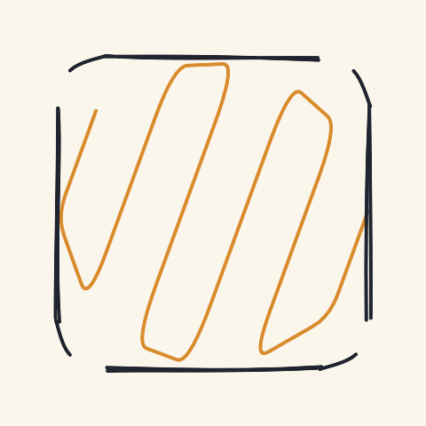

```swift
RoughView()
    .fill(Color(red: 0.85, green: 0.55, blue: 0.18))
    .fillStyle(.scribble)
    .scribble(origin: 110, tightness: 11, curvature: 36)
    .fillWeight(2)
    .stroke(Color(red: 0.12, green: 0.14, blue: 0.18))
    .strokeWidth(2)
    .seed(77)
    .roundedRectangle(cornerRadius: 28)
```

### Scribble bands

A tightness pattern splits the traversal into sparse and dense bands.

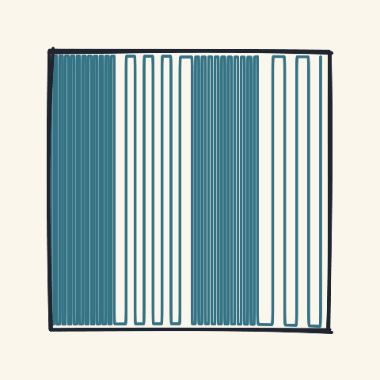

```swift
RoughView()
    .fill(Color(red: 0.20, green: 0.45, blue: 0.52))
    .fillStyle(.scribble)
    .scribble(origin: 90, tightnessPattern: [6, 24, 8, 28], curvature: 10)
    .fillWeight(1.8)
    .stroke(Color(red: 0.12, green: 0.14, blue: 0.18))
    .strokeWidth(2)
    .seed(81)
    .rectangle()
```

### Brush scribble

scribbleUseBrushStroke draws the zig-zag with the current brush. This one uses the calligraphic preset.

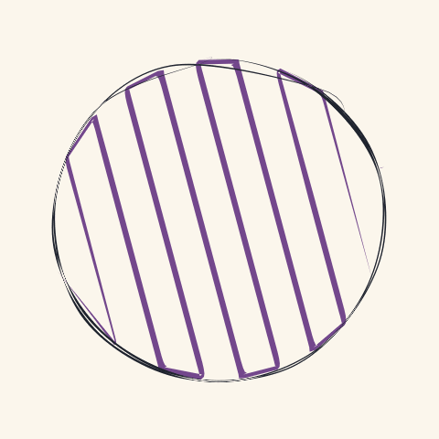

```swift
RoughView()
    .fill(Color(red: 0.45, green: 0.28, blue: 0.55))
    .fillStyle(.scribble)
    .scribble(origin: 75, tightness: 12, curvature: 8, useBrushStroke: true)
    .fillWeight(6)
    .stroke(Color(red: 0.12, green: 0.14, blue: 0.18))
    .strokeWidth(2)
    .brushProfile(.calligraphic)
    .seed(88)
    .circle()
```

## Strokes

### Several strokes

One view can draw several lines. Each outline is itself two offset passes.

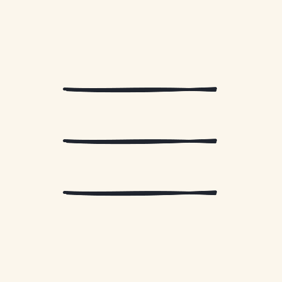

```swift
RoughView()
    .stroke(Color(red: 0.12, green: 0.14, blue: 0.18))
    .strokeWidth(2.5)
    .roughness(1.4)
    .seed(91)
    .draw(Line(from: Point(x: 28, y: 48), to: Point(x: 156, y: 48)))
    .draw(Line(from: Point(x: 28, y: 92), to: Point(x: 156, y: 92)))
    .draw(Line(from: Point(x: 28, y: 136), to: Point(x: 156, y: 136)))
```

### Thick stroke

strokeWidth(12) with square caps and bevel joins on an open polyline.

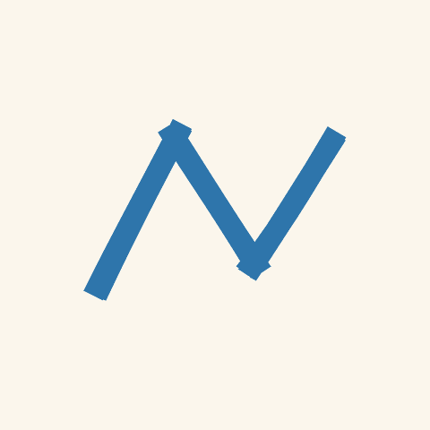

```swift
RoughView()
    .stroke(Color(red: 0.18, green: 0.46, blue: 0.67))
    .strokeWidth(12)
    .strokeCap(.square)
    .strokeJoin(.bevel)
    .seed(97)
    .draw(LinearPath(points: [
        Point(x: 28, y: 132),
        Point(x: 70, y: 48),
        Point(x: 114, y: 120),
        Point(x: 156, y: 52)
    ]))
```

### Stroke opacity

strokeOpacity takes 0 to 100. Here the outline is 40, over a solid fill.

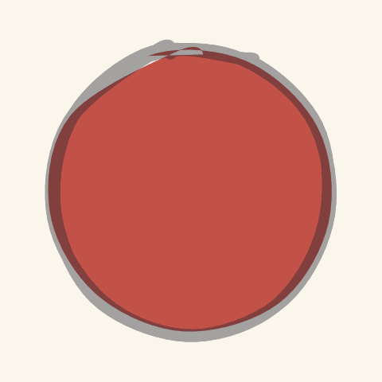

```swift
RoughView()
    .fill(Color(red: 0.76, green: 0.32, blue: 0.28))
    .fillStyle(.solid)
    .stroke(Color(red: 0.12, green: 0.14, blue: 0.18))
    .strokeWidth(8)
    .strokeOpacity(40)
    .seed(101)
    .circle()
```

### Fill opacity

fillOpacity(35) lets the paper show through a solid interior.

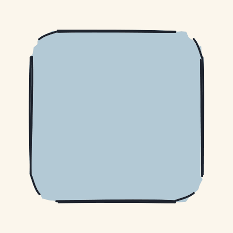

```swift
RoughView()
    .fill(Color(red: 0.18, green: 0.46, blue: 0.67))
    .fillStyle(.solid)
    .fillOpacity(35)
    .stroke(Color(red: 0.12, green: 0.14, blue: 0.18))
    .strokeWidth(2)
    .seed(104)
    .roundedRectangle(cornerRadius: 28)
```

## Roughness

### Even outline

Roughness, bowing, and maxRandomnessOffset at zero leave a nearly even double outline.

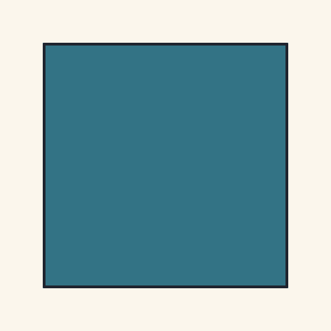

```swift
RoughView()
    .fill(Color(red: 0.20, green: 0.45, blue: 0.52))
    .fillStyle(.solid)
    .stroke(Color(red: 0.12, green: 0.14, blue: 0.18))
    .strokeWidth(2)
    .roughness(0)
    .bowing(0)
    .maxRandomnessOffset(0)
    .seed(108)
    .rectangle()
```

### Rough outline

roughness(2.8) scales the jitter on the outline and the fill.

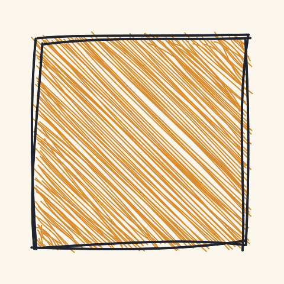

```swift
RoughView()
    .fill(Color(red: 0.85, green: 0.55, blue: 0.18))
    .fillStyle(.hachure)
    .fillSpacing(3)
    .stroke(Color(red: 0.12, green: 0.14, blue: 0.18))
    .strokeWidth(2)
    .roughness(2.8)
    .seed(111)
    .rectangle()
```

### Bowed edges

bowing(6) bends each edge. maxRandomnessOffset(3) is how far that bend can travel.

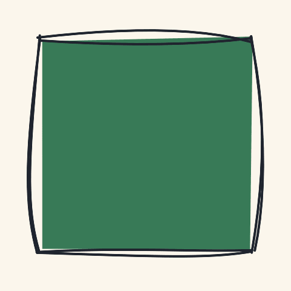

```swift
RoughView()
    .fill(Color(red: 0.22, green: 0.48, blue: 0.34))
    .fillStyle(.solid)
    .stroke(Color(red: 0.12, green: 0.14, blue: 0.18))
    .strokeWidth(2)
    .roughness(1)
    .bowing(6)
    .maxRandomnessOffset(3)
    .seed(115)
    .rectangle()
```

### Loose double stroke

maxRandomnessOffset(6) sets how far the two outline passes wander from the true edge.

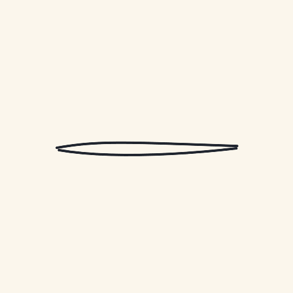

```swift
RoughView()
    .stroke(Color(red: 0.12, green: 0.14, blue: 0.18))
    .strokeWidth(2)
    .roughness(1.6)
    .bowing(1)
    .maxRandomnessOffset(6)
    .seed(120)
    .draw(Line(from: Point(x: 20, y: 92), to: Point(x: 164, y: 92)))
```

## Brushes

### Calligraphic brush

The calligraphic preset uses a flat tip at 45° and tapered ends.

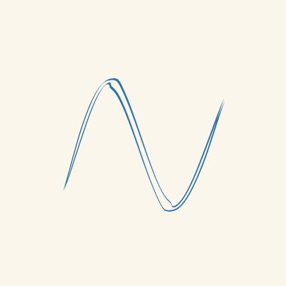

```swift
RoughView()
    .stroke(Color(red: 0.18, green: 0.46, blue: 0.67))
    .strokeWidth(8)
    .brushProfile(.calligraphic)
    .seed(123)
    .draw(Curve(points: [
        Point(x: 24, y: 132),
        Point(x: 64, y: 40),
        Point(x: 116, y: 148),
        Point(x: 160, y: 56)
    ]))
```

### Marker

The marker preset is a flat tip with butt caps and bevel joins.

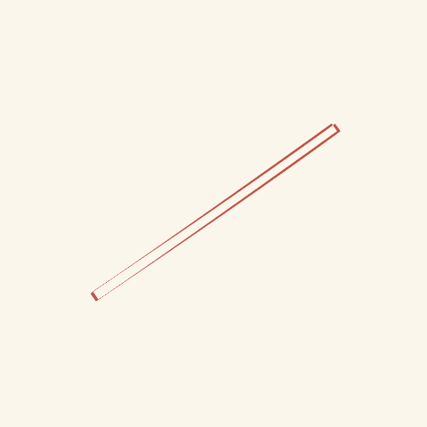

```swift
RoughView()
    .stroke(Color(red: 0.76, green: 0.32, blue: 0.28))
    .strokeWidth(16)
    .brushProfile(.marker)
    .seed(127)
    .draw(Line(from: Point(x: 24, y: 140), to: Point(x: 160, y: 44)))
```

### Pen pressure

The pen preset swells through the middle of the stroke.

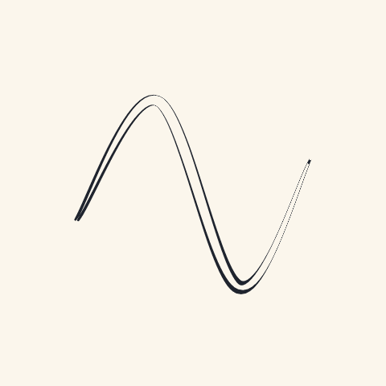

```swift
RoughView()
    .stroke(Color(red: 0.12, green: 0.14, blue: 0.18))
    .strokeWidth(7)
    .brushProfile(.pen)
    .seed(131)
    .draw(Curve(points: [
        Point(x: 20, y: 110),
        Point(x: 70, y: 36),
        Point(x: 120, y: 150),
        Point(x: 164, y: 72)
    ]))
```

### Crayon stroke

A wax ring. The crayon seed pins the grit, and strokeWidth is the wax width in points.

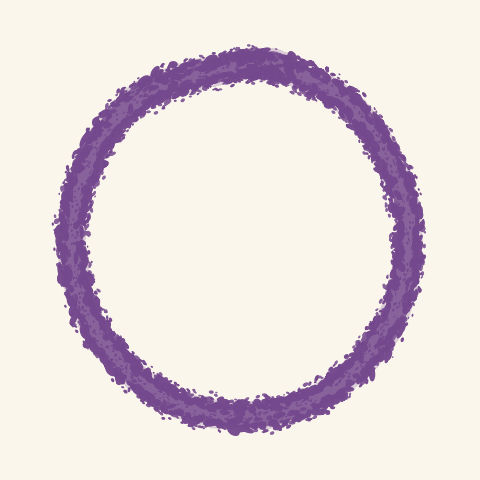

```swift
RoughView()
    .stroke(Color(red: 0.45, green: 0.28, blue: 0.55))
    .strokeWidth(11)
    .brushProfile(.crayon(grit: 0.95, flakeSize: 1.5, seed: 4))
    .seed(4)
    .circle()
```

### Crayon fill

Hachure lines use the same wax. fillWeight is the width of each line. The preset crayon seed follows Options.seed.

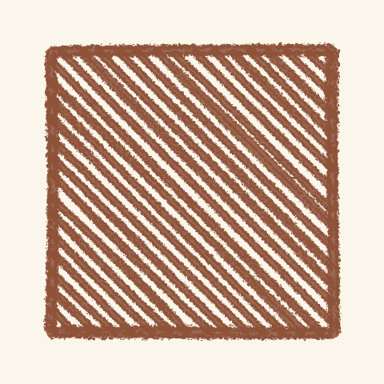

```swift
RoughView()
    .fill(Color(red: 0.55, green: 0.32, blue: 0.22))
    .fillStyle(.hachure)
    .fillAngle(45)
    .fillWeight(3.5)
    .fillSpacing(2.4)
    .stroke(Color(red: 0.55, green: 0.32, blue: 0.22))
    .strokeWidth(5)
    .brushProfile(.crayon)
    .seed(12)
    .rectangle()
```

### Tapered pen

thicknessProfile(.naturalPen) tapers both ends of an open curve.

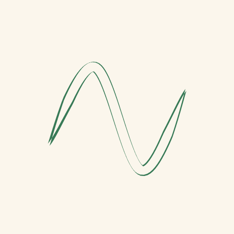

```swift
RoughView()
    .stroke(Color(red: 0.22, green: 0.48, blue: 0.34))
    .strokeWidth(10)
    .thicknessProfile(.naturalPen)
    .seed(137)
    .draw(Curve(points: [
        Point(x: 22, y: 120),
        Point(x: 68, y: 40),
        Point(x: 118, y: 146),
        Point(x: 162, y: 64)
    ]))
```

## Seeding

### Seed 7

A circle pinned with seed 7.


```swift
RoughView()
    .fill(Color(red: 0.18, green: 0.46, blue: 0.67))
    .fillStyle(.hachure)
    .fillAngle(40)
    .fillSpacing(3)
    .stroke(Color(red: 0.12, green: 0.14, blue: 0.18))
    .strokeWidth(2)
    .roughness(2.2)
    .seed(7)
    .circle()
```

### Seed 7, again

The same circle and the same seed. The strokes match the previous tile.

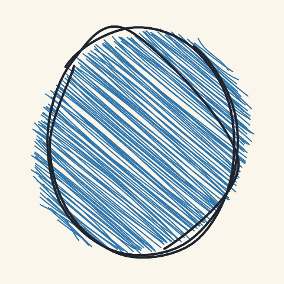

```swift
RoughView()
    .fill(Color(red: 0.18, green: 0.46, blue: 0.67))
    .fillStyle(.hachure)
    .fillAngle(40)
    .fillSpacing(3)
    .stroke(Color(red: 0.12, green: 0.14, blue: 0.18))
    .strokeWidth(2)
    .roughness(2.2)
    .seed(7)
    .circle()
```

### Seed 99

The same circle with seed 99. The wobble is a different drawing.

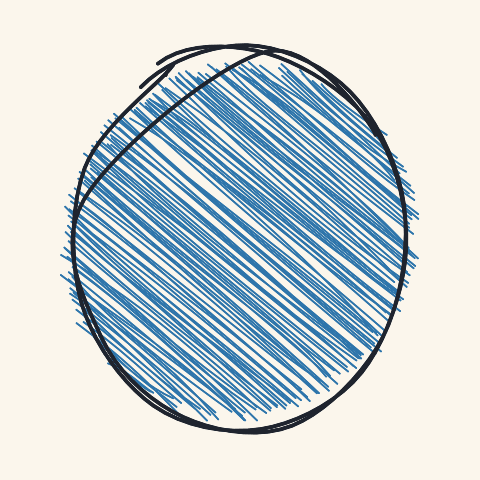

```swift
RoughView()
    .fill(Color(red: 0.18, green: 0.46, blue: 0.67))
    .fillStyle(.hachure)
    .fillAngle(40)
    .fillSpacing(3)
    .stroke(Color(red: 0.12, green: 0.14, blue: 0.18))
    .strokeWidth(2)
    .roughness(2.2)
    .seed(99)
    .circle()
```

## SVG

### SVG star

An SVG path string, scaled to the card. svgStrokeWidth overrides the outline width.

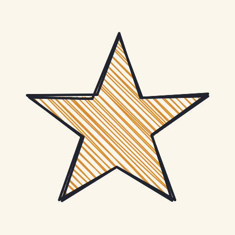

```swift
RoughView()
    .fill(Color(red: 0.85, green: 0.55, blue: 0.18))
    .fillStyle(.hachure)
    .fillAngle(45)
    .fillSpacing(3)
    .stroke(Color(red: 0.12, green: 0.14, blue: 0.18))
    .svgStrokeWidth(2.5)
    .seed(141)
    .draw(Path(d: "M50,5 L63,40 L100,40 L70,62 L82,98 L50,78 L18,98 L30,62 L0,40 L37,40 Z"))
```

### Outside SVG stroke

svgFillStrokeAlignment(.outside) lays the stroke on the outer edge. svgFillWeight sets the fill-line width.

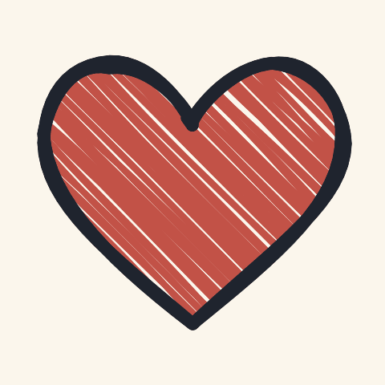

```swift
RoughView()
    .fill(Color(red: 0.76, green: 0.32, blue: 0.28))
    .fillStyle(.hachure)
    .fillSpacing(3)
    .stroke(Color(red: 0.12, green: 0.14, blue: 0.18))
    .svgStrokeWidth(8)
    .svgFillWeight(2)
    .svgFillStrokeAlignment(.outside)
    .seed(144)
    .draw(Path(d: "M50,28 C50,28 38,8 22,8 C8,8 0,20 0,34 C0,55 22,72 50,96 C78,72 100,55 100,34 C100,20 92,8 78,8 C62,8 50,28 50,28 Z"))
```

## Text

### Rough text

Text is traced to a path and centered. The letters take the same hachure as a shape.

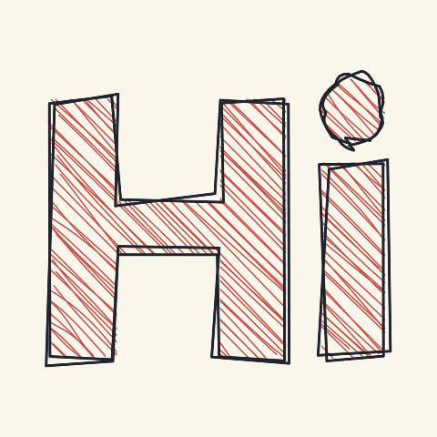

```swift
RoughView()
    .fill(Color(red: 0.76, green: 0.32, blue: 0.28))
    .fillStyle(.hachure)
    .fillAngle(45)
    .fillSpacing(2)
    .stroke(Color(red: 0.12, green: 0.14, blue: 0.18))
    .strokeWidth(1.5)
    .seed(151)
    .text("Hi", font: .systemFont(ofSize: 76, weight: .heavy))
```

### Named font

A PostScript font name. The glyphs are fitted to the card and filled solid.

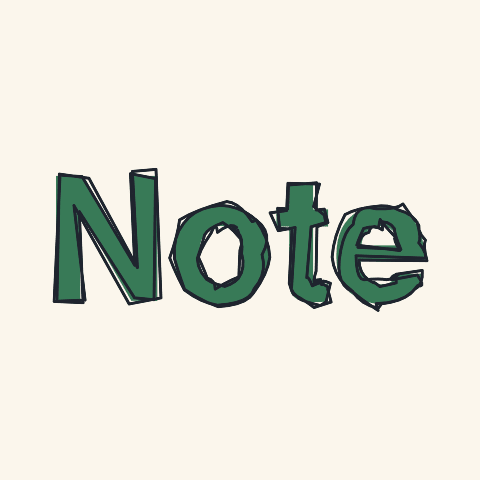

```swift
RoughView()
    .fill(Color(red: 0.22, green: 0.48, blue: 0.34))
    .fillStyle(.solid)
    .stroke(Color(red: 0.12, green: 0.14, blue: 0.18))
    .strokeWidth(1.5)
    .seed(155)
    .text("Note", fontName: "Helvetica-Bold", fontSize: 48)
```

## Animation

### Breathing circle

A seeded cross-hatch circle. AnimationConfig.seed replays the same wobble.

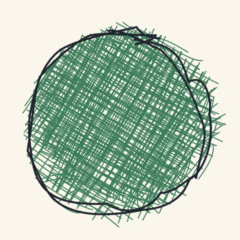

```swift
RoughView()
    .fill(Color(red: 0.22, green: 0.48, blue: 0.34))
    .fillStyle(.crossHatch)
    .fillAngle(30)
    .fillSpacing(3)
    .stroke(Color(red: 0.12, green: 0.14, blue: 0.18))
    .strokeWidth(2)
    .seed(42)
    .circle()
    .animated(config: AnimationConfig(steps: 6, speed: .medium, variance: .high, seed: 42))
```

### Slow breath

Very low variance and the slow step, 600 ms. The GIF plays the four frames at 2 fps.

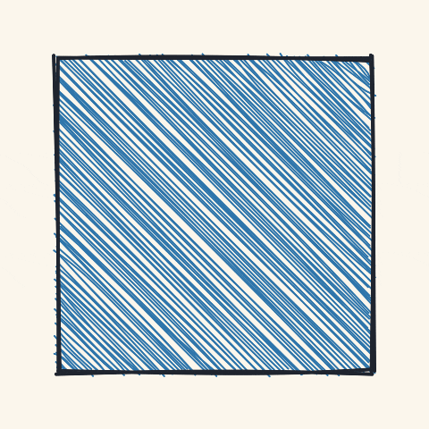

```swift
RoughView()
    .fill(Color(red: 0.18, green: 0.46, blue: 0.67))
    .fillStyle(.hachure)
    .fillAngle(45)
    .fillSpacing(3)
    .stroke(Color(red: 0.12, green: 0.14, blue: 0.18))
    .strokeWidth(2)
    .seed(30)
    .rectangle()
    .animated(config: AnimationConfig(steps: 4, speed: .slow, variance: .veryLow, seed: 30))
```

### Low wobble

Low variance (1%) on a seeded ellipse, played at 3 fps for the medium step.


```swift
RoughView()
    .fill(Color(red: 0.76, green: 0.32, blue: 0.28))
    .fillStyle(.solid)
    .stroke(Color(red: 0.12, green: 0.14, blue: 0.18))
    .strokeWidth(2)
    .roughness(1.4)
    .seed(32)
    .draw(Ellipse(x: 92, y: 92, width: 150, height: 110))
    .animated(config: AnimationConfig(steps: 4, speed: .medium, variance: .low, seed: 32))
```

### Sketch cycle

Medium variance on a triangle, five steps, played at 3 fps.


```swift
RoughView()
    .fill(Color(red: 0.85, green: 0.55, blue: 0.18))
    .fillStyle(.hachure)
    .fillSpacing(3)
    .stroke(Color(red: 0.12, green: 0.14, blue: 0.18))
    .strokeWidth(2)
    .seed(34)
    .draw(Polygon(points: [
        Point(x: 92, y: 24),
        Point(x: 160, y: 156),
        Point(x: 24, y: 156)
    ]))
    .animated(config: AnimationConfig(steps: 5, speed: .medium, variance: .medium, seed: 34))
```

### Fast jitter

High variance and the fast step, 100 ms. The GIF plays the four frames at 10 fps.


```swift
RoughView()
    .fill(Color(red: 0.45, green: 0.28, blue: 0.55))
    .fillStyle(.zigzag)
    .fillAngle(30)
    .fillSpacing(3.5)
    .stroke(Color(red: 0.12, green: 0.14, blue: 0.18))
    .strokeWidth(2)
    .seed(38)
    .circle()
    .animated(config: AnimationConfig(steps: 4, speed: .fast, variance: .high, seed: 38))
```

### Eight steps

Eight variation steps before the loop repeats. Medium variance, played at 3 fps.


```swift
RoughView()
    .fill(Color(red: 0.20, green: 0.45, blue: 0.52))
    .fillStyle(.dots)
    .fillSpacing(2.4)
    .stroke(Color(red: 0.12, green: 0.14, blue: 0.18))
    .strokeWidth(2)
    .seed(40)
    .circle()
    .animated(config: AnimationConfig(steps: 8, speed: .medium, variance: .medium, seed: 40))
```

### Scribble wobble

A scribble fill takes the same seeded wobble. Medium variance, five steps, played at 3 fps.


```swift
RoughView()
    .fill(Color(red: 0.22, green: 0.48, blue: 0.34))
    .fillStyle(.scribble)
    .scribble(origin: 20, tightness: 12, curvature: 12)
    .stroke(Color(red: 0.12, green: 0.14, blue: 0.18))
    .strokeWidth(2)
    .seed(46)
    .circle()
    .animated(config: AnimationConfig(steps: 5, speed: .medium, variance: .medium, seed: 46))
```
